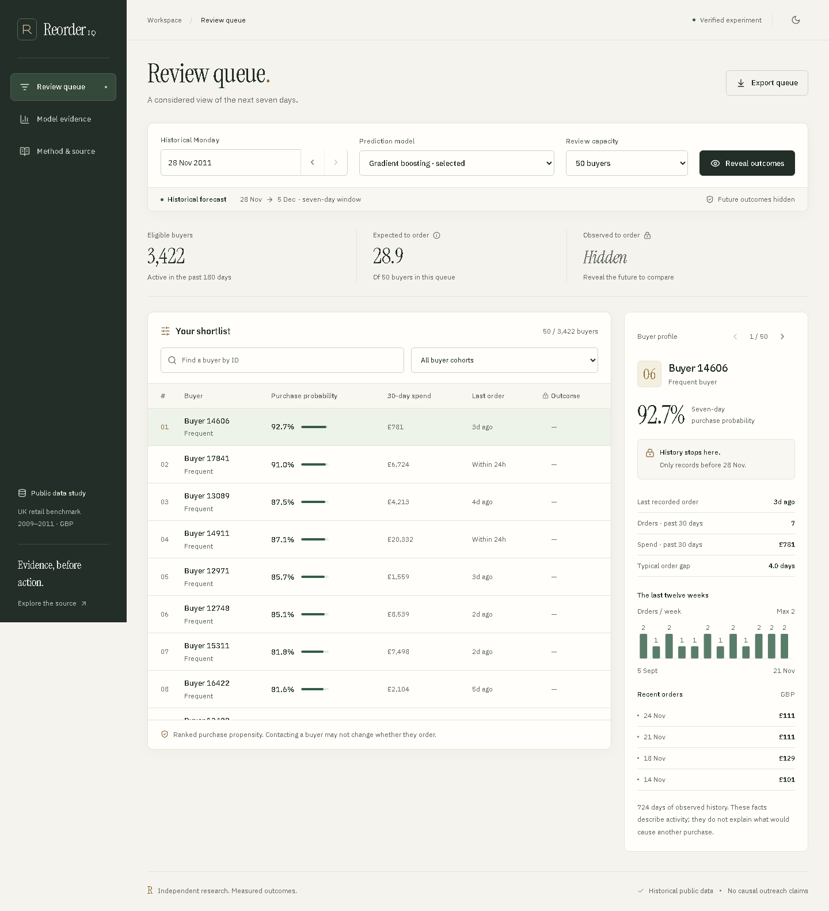

# ReorderIQ

[](https://github.com/Stark2028/reorderiq/actions/workflows/ci.yml)

**[Open the live AWS demo](https://reorderiq.65.0.103.235.sslip.io)** · [Deployment and rollback](deploy/aws/README.md)

**Which observed buyers are likely to order in the next seven days? Inspect the prediction, then replay what happened.**

A complete local data science application: official retail transactions, SQL features, chronological model comparison, independent probability calibration, and a React/TypeScript review workspace with Framer Motion. Built as an independent portfolio study inspired by predictive buying research at Udaan.



## Start locally

Python 3.12 is the verified runtime. From this directory in PowerShell:

```powershell
python -m venv .venv
.\.venv\Scripts\python.exe -m pip install -r requirements.lock
.\.venv\Scripts\python.exe -m pip install --no-deps -e .
.\.venv\Scripts\python.exe -m reorderiq.cli run
.\start.ps1
```

Open **http://127.0.0.1:8010**. The first experiment downloads the official UCI archive (~43 MB), reads both workbook sheets and creates local artifacts. Later runs use hash-checked caches. A prepared experiment already exists on the development machine; `start.ps1` can serve it immediately if the required packages are available.

For macOS/Linux, activate `.venv`, install the same requirements/project and run `python -m reorderiq.cli serve`. No API keys or external database service are needed. The committed React interface is prebuilt, so serving it requires only Python. Browser checks require `python -m playwright install chromium` once if Chromium is not installed.

## Frontend development

Node 24 is the verified build runtime. From this directory:

```powershell
cd frontend
npm ci
npm run typecheck
npm test -- --maxWorkers=1
npm run build
cd ..
.\start.ps1
```

`npm run build` compiles React, TypeScript, Motion for React (formerly Framer Motion), local fonts and lazy evidence/method views into the Python package. `npm run dev` runs Vite on port 3010 with API requests proxied to the local Python server. `npm run format:check` keeps the source consistent. Dependencies are recorded in frontend/package-lock.json.

## What is implemented

- Official source download, SHA-256 provenance, sequential cleaning audit and invoice-level purchase events.
- Inspectable SQLite SQL features at weekly Monday cutoffs. Strict historical features, matured seven-day labels and a documented eligible population.
- Recency, empirical Bayes Gamma-Poisson, logistic regression and histogram gradient boosting with fixed settings.
- Two development folds, independent calibration in each fold, and a later final temporal holdout. Choice is persisted before final fitting.
- Weekly average precision, Brier loss, calibration bins, precision/recall/lift at fixed review capacities, cohort analysis and paired temporal stability intervals.
- Buyer review queue with date/model/capacity/search/cohort controls, pre-cutoff history, explicit outcome reveal, CSV export, evidence and methodology views.
- Refined light/dark themes, editorial typography, restrained motion, keyboard-inspectable charts and a mobile buyer sheet with focus restoration. Reduced motion is respected.
- Current-query guards prevent stale exports/details. Recoverable artifact errors, startup load locking, strict label checks, gzip compression and hashed-asset caching improve reliability.
- Hash-checked immutable run artifacts, source snapshots, model bundles, a full evidence verifier and engineering handoff records.

## Measured result

The official source normalizes to **36,553 orders / 5,851 buyers**. The final evaluation contains **39,754 buyer-weeks, 3,874 distinct buyers and 13 weekly origins**. Gradient boosting was selected on development data before the final holdout.

| Model | Mean weekly average precision | Brier loss ↓ | Precision @50 |
|---|---:|---:|---:|
| Recency | 0.1254 | 0.0927 | 8.9% |
| Gamma-Poisson | 0.2892 | 0.0854 | 57.4% |
| Logistic regression | 0.3036 | 0.0844 | 57.1% |
| Gradient boosting | **0.3132** | **0.0841** | **59.2%** |

These are predictive metrics on historical public data. Precision@50 is the average fraction of the selected 50 buyers who actually ordered, not classification accuracy or orders caused by contact. Compared with Gamma-Poisson, the mean AP difference is +0.0240; the top-50 precision difference is +1.85 percentage points, with a temporal stability interval spanning zero. See [measured results](reports/RESULTS.md) and [model card](docs/MODEL_CARD.md).

## Reproduce and verify

```powershell
.\.venv\Scripts\python.exe -m reorderiq.cli prepare
.\.venv\Scripts\python.exe -m reorderiq.cli run
.\.venv\Scripts\python.exe -m reorderiq.cli verify
.\.venv\Scripts\python.exe -m pytest -q -W error --basetemp=.test-tmp-local
.\.venv\Scripts\python.exe -m ruff check src tests scripts
.\.venv\Scripts\python.exe scripts/export_figures.py
```

With the local server running, run `python scripts/browser_check.py` for desktop/mobile replay, filtering, export freshness, modal focus, normal/reduced motion and recovery checks. The refined application passes **42 Python tests, 4 frontend tests and 12 browser flows**. [Refinement verification](verification/REFINEMENT.md) records local results; [original verification](verification/VERIFICATION.md) preserves the initial experiment/build record. [GitHub Actions](https://github.com/Stark2028/reorderiq/actions) runs the Python and frontend CI checks.

To package changes on Windows, run `.\scripts\build_distribution.ps1`, then `python scripts/verify_distribution.py` with the local server running. The clean-build step removes only verified generated setuptools output, preventing obsolete UI files from entering a repeated wheel build. Distribution verification compares every shipped runtime file against current source and checks real gzip/cache/version behavior.

Each `runs/<id>/` includes config, source/data/code hashes, source archive, selection record, predictions, snapshots, orders, calibrated model bundles, JSON/Markdown report and a completion manifest. `runs/latest.json` selects the last completed run. The API never trains a model or loads joblib files. A failed or corrupted experiment is explicitly unavailable; it does not trigger a synthetic fallback.

## Project map

```text
MASTER_PLAN.md / TODO.md       Architecture, frozen protocol and phase gates
docs/HANDOFF.md               Portable project state and working procedure
MEMORY.md / BUGS.md / TRAPS.md Local-only detailed memory, public defects and risk records
src/reorderiq/ingest.py        Acquisition, normalization and audit
src/reorderiq/sql/             Inspectable snapshot features
src/reorderiq/features.py      Temporal/eligibility contracts
src/reorderiq/models.py        Candidates and independent calibration
src/reorderiq/metrics.py       Denominators, ranking and stability intervals
src/reorderiq/pipeline.py      Reproducible experiment and artifact publication
src/reorderiq/verify.py        Rebuild populations, labels, features and metrics
src/reorderiq/api.py / web/    Local evidence API and packaged production interface
frontend/src/                 Typed React components, request guards, themes and motion
tests/                        Leakage, cleaning, models, metrics and API regressions
docs/                         Data/model cards, architecture and interview notes
reports/ / verification/      Shareable measured evidence and browser captures
data/ / runs/                 Ignored local source data and experiment artifacts
```

## Data and scope

[Online Retail II](https://archive.ics.uci.edu/dataset/502/online+retail+ii), Chen, D. (2012), DOI:10.24432/C5CG6D, **CC BY 4.0**. UK giftware transactions from 2009–2011; many customers were wholesalers. Currency is GBP. These are not Udaan transactions or current Indian kirana data. The target is a positive merchandise order placed; cancellations, adjustments and returns are not netted into a profit target. See [data card](docs/DATA_CARD.md).

The dataset has no randomized contact history. Purchase propensity cannot establish the incremental effect of outreach. New-customer acquisition, causal targeting, live retailer integrations and production hosting are future work. Outcome reveal is a replay control, not an authorization boundary. The app defaults to loopback and has no authentication.

Project motivation: De, Singh and Patel, [A Machine Learning and Empirical Bayesian Approach for Predictive Buying in B2B E-commerce](https://arxiv.org/html/2403.07843v1), 2024. ReorderIQ does not reproduce that paper's private dataset, modified model or reported business impact.

Fonts: locally bundled IBM Plex Sans and Instrument Serif under their included OFL licenses. Runtime React, Motion and Lucide notices are bundled in src/reorderiq/web/ui/licenses/. Assistance: implementation and verification developed with OpenAI Codex; results are from actual local experiments and checks.
