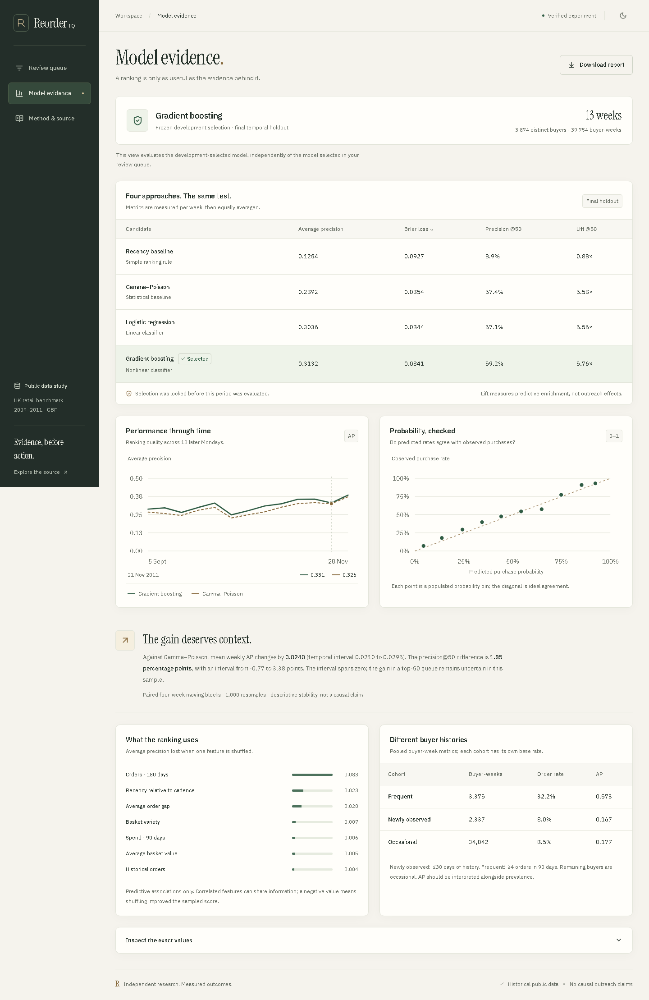
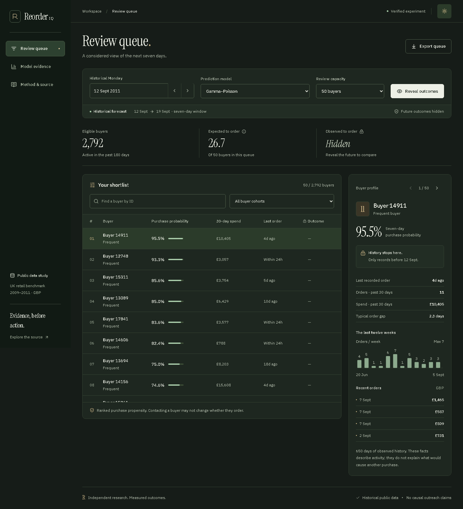
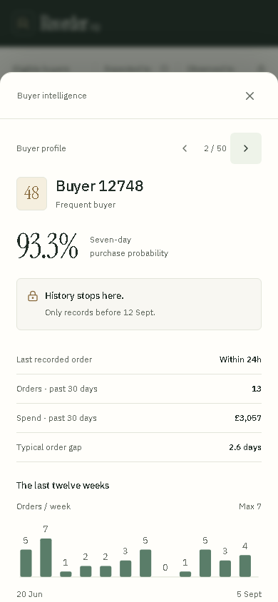
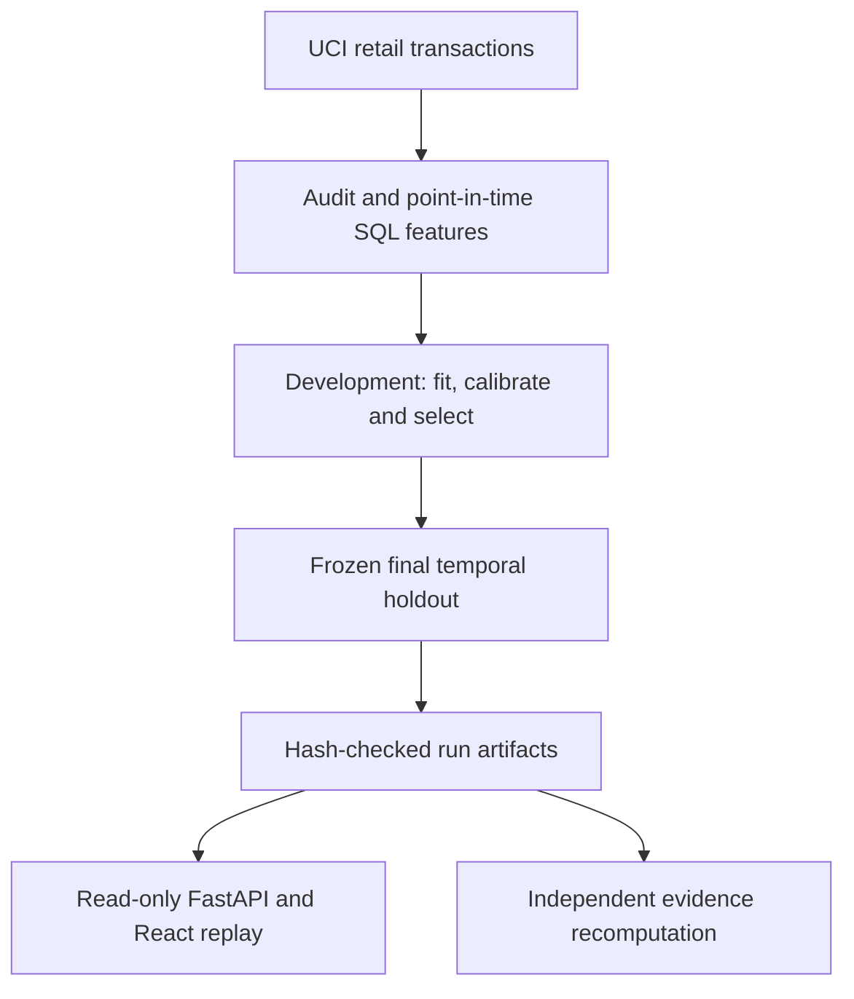

# ReorderIQ

**Predict the next order. Inspect the evidence. Replay what happened.**

A deployed retail data science application that ranks observed buyers by their probability of ordering in the next seven days. ReorderIQ connects audited transactions, SQL feature engineering, chronological model evaluation and calibrated probabilities to an interactive buyer review workspace.

[](https://github.com/Stark2028/reorderiq/actions/workflows/ci.yml)

**[Live demo](https://reorderiq.65.0.103.235.sslip.io)** · [Measured results](reports/RESULTS.md) · [Model card](docs/MODEL_CARD.md) · [Run locally](#run-locally) · [Deployment](deploy/aws/README.md)


**36,553 orders · 5,851 observed buyers · 17 historical features · 4 candidate models**

## Measured results

Gradient boosting was selected on development folds **before** the final holdout. All candidates below were evaluated on the same **39,754 buyer-weeks, 3,874 distinct buyers and 13 weekly origins**.

| Candidate | Mean weekly average precision ↑ | Brier loss ↓ | Precision@50 ↑ |
|---|---:|---:|---:|
| Recency baseline | 0.1254 | 0.0927 | 8.9% |
| Empirical Bayes Gamma-Poisson | 0.2892 | 0.0854 | 57.4% |
| Logistic regression | 0.3036 | 0.0844 | 57.1% |
| **Histogram gradient boosting** | **0.3132** | **0.0841** | **59.2%** |

Metrics are computed per week and then equally averaged. **59.2% precision@50** means that, on average, about 30 of the 50 highest-ranked buyers placed an eligible order in the following week. It does not measure orders caused by contacting them.

Against Gamma-Poisson, gradient boosting improves mean weekly average precision by **0.0240**. Its precision@50 difference is **+1.85 percentage points**, with a four-week moving-block temporal stability interval of **−0.77 to +3.38 points**. That interval spans zero; the observed top-50 gain remains uncertain. [Full results and interpretation →](reports/RESULTS.md)

## Explore the demo

No account or API key is needed. The live application serves the recorded, verified historical experiment.

1. **Review the queue.** Choose a historical Monday, model and review capacity. Inspect ranked buyers and their pre-cutoff purchase history.
2. **Reveal the next week.** Show whether each selected buyer actually ordered. Changing the date resets the reveal state.
3. **Inspect model evidence.** Compare ranking performance, calibration, buyer cohorts and feature importance. This view always evaluates the development-selected model, independently of the queue's model filter.
4. **Export your view.** Download a CSV matching the active filters and reveal state, or read the source audit under **Method & source**.

The workspace includes mobile buyer inspection, keyboard navigation, light/dark themes and reduced-motion support. Failed queries disable stale exports and offer a retry.

<details>
<summary>More views: model evidence, dark theme and mobile inspection</summary>

**Model evidence**



**Dark theme**



**Mobile buyer inspection**



</details>

## Architecture



| Layer | Implementation |
|---|---|
| Data | Python, pandas, NumPy, SQLite SQL, Parquet; sequential cleaning audit and source hashes |
| Modeling | scikit-learn, SciPy; recency, empirical Bayes Gamma-Poisson, logistic regression and histogram gradient boosting |
| Evaluation | Temporal folds, independent probability calibration, weekly ranking metrics, Brier loss, cohorts and paired time-block intervals |
| Application | FastAPI, React, TypeScript, Vite, Motion for React (formerly Framer Motion) |
| Delivery | Docker, AWS EC2 and Caddy HTTPS; GitHub Actions on Linux/Windows plus frontend checks |

**Modeling runs offline.** HTTP requests read verified predictions and historical orders; they never train a model or load joblib bundles. Frontend and API share one origin. Hashed production assets are cached, API responses use `no-store`, and concurrent first requests share one artifact loader.

### Temporal evaluation

The target is **at least one eligible positive merchandise order in the next seven days**, among previously observed buyers whose last qualifying order was within 180 days.

| Boundary | Enforced rule |
|---|---|
| Historical features | Only events with `ordered_at < as_of` |
| Outcome window | `as_of <= ordered_at < as_of + 7 days` |
| Label maturity | The full seven-day outcome window must be observed before evaluation |
| Model selection | Two development folds; a separate calibration interval in each fold; selection frozen before final evaluation |

The 17 features cover recency, observed tenure, purchase frequency, spend, basket characteristics and reorder cadence. SQL computes historical aggregates and future labels separately. The final holdout contains Mondays from **5 September through 28 November 2011**; models remain frozen within each fold.

`verify` goes beyond checking hashes: it rebuilds weekly eligible populations, historical features and future order labels from saved orders, checks identical buyer/date keys across all candidates, and recomputes reported metrics. [Architecture and API contracts](docs/ARCHITECTURE.md) · [Exact evaluation protocol](MASTER_PLAN.md)

## Run locally

Use **Python 3.12**. Node is needed only when editing the frontend; the production interface is already included. No external database or API key is required.

```sh
git clone https://github.com/Stark2028/reorderiq.git
cd reorderiq
```

<details open>
<summary>Windows / PowerShell</summary>

```powershell
python -m venv .venv
.\.venv\Scripts\python.exe -m pip install -r requirements.lock
.\.venv\Scripts\python.exe -m pip install --no-deps -e .
.\.venv\Scripts\python.exe -m reorderiq.cli run
.\.venv\Scripts\python.exe -m reorderiq.cli serve
```

</details>

<details>
<summary>macOS / Linux</summary>

```sh
python3.12 -m venv .venv
.venv/bin/python -m pip install -r requirements.lock
.venv/bin/python -m pip install --no-deps -e .
.venv/bin/python -m reorderiq.cli run
.venv/bin/python -m reorderiq.cli serve
```

</details>

Open **http://127.0.0.1:8010**. The first `run` downloads the official UCI archive (~43 MB), reads both workbook sheets, prepares data, fits/calibrates the candidates and writes a completed experiment. Later runs reuse hash-checked data caches. Source downloads and generated runs are intentionally excluded from Git.

`runs/latest.json` selects the last completed experiment. An incomplete or corrupted run produces an explicit unavailable response rather than synthetic data. Restart the server to adopt a different completed run.

### Verification and frontend development

Activate your virtual environment before these commands:

```sh
python -m reorderiq.cli verify
python -m pytest -q -W error --basetemp=.test-tmp-local
python -m ruff check src tests scripts
```

Recorded verification: **42 Python tests, 4 frontend request-state tests and 12 browser flows**. The public AWS deployment passed the browser flows with **zero JavaScript errors**, and its experiment was independently reverified inside the deployed container. These are recorded checks; the CI badge above shows the latest hosted status. [Deployment evidence](verification/DEPLOYMENT.md) · [Local refinement evidence](verification/REFINEMENT.md)

To run browser checks, install Chromium once with `python -m playwright install chromium`. With the app running:

```sh
python scripts/browser_check.py
```

For frontend changes, use **Node 24**:

```sh
cd frontend
npm ci
npm run format:check
npm test -- --maxWorkers=1
npm run build
```

`npm run dev` starts Vite on port 3010 and proxies API requests to the local Python server. `npm run build` type-checks the frontend and packages production assets into the Python application. Python dependencies are pinned in `requirements.lock`; frontend dependencies are pinned in `frontend/package-lock.json`.

## Navigate the repository

| Start here | What you will find |
|---|---|
| [Measured results](reports/RESULTS.md) / [figures](reports/figures/) | Actual final-holdout comparisons, denominators and uncertainty |
| [Data card](docs/DATA_CARD.md) / [model card](docs/MODEL_CARD.md) | Source, target definition, selection protocol and limitations |
| [Architecture](docs/ARCHITECTURE.md) | Pipeline, artifact lifecycle, client behavior and API contracts |
| [SQL features](src/reorderiq/sql/) / [models](src/reorderiq/models.py) | Inspectable feature engineering and candidate implementations |
| [Evidence verifier](src/reorderiq/verify.py) / [tests](tests/) | Rebuilt labels/features/metrics and regression checks |
| [Frontend](frontend/src/) | Typed request state, buyer replay, evidence views and motion |
| [Deployment runbook](deploy/aws/README.md) | Private artifact transfer, readiness checks, HTTPS activation and rollback |
| [Engineering records](docs/HANDOFF.md) | Handoff context, with [plan](MASTER_PLAN.md), [checklist](TODO.md), [bugs](BUGS.md) and [traps](TRAPS.md) |

Each completed run preserves configuration, data/code fingerprints, the frozen selection record, source snapshot, predictions, model bundles and measured reports. Application v0.2 is documented separately from the original experiment's source snapshot; UI and serving improvements do not rewrite experimental provenance.

## Data, scope and attribution

**Source:** Chen, D. (2012), [Online Retail II](https://archive.ics.uci.edu/dataset/502/online+retail+ii), UCI, DOI:10.24432/C5CG6D, **CC BY 4.0**. Its 1,067,371 invoice lines come from a UK giftware retailer in 2009–2011; many customers were wholesalers. Currency is GBP. After the documented cleaning and aggregation rules, the study contains 36,553 eligible orders and 5,851 observed buyers.

This is an independent portfolio study inspired by De, Singh and Patel's [predictive buying research in B2B e-commerce](https://arxiv.org/html/2403.07843v1). It uses public data, is not affiliated with Udaan, and does not reproduce the paper's private dataset or reported business impact.

The model predicts observed purchases. There is no randomized contact history, so it cannot estimate incremental outreach effects or revenue. Missing customer IDs, left-truncated buyer histories, seasonal drift and the historical UK domain limit generalization. Returns are not netted into a profit target, and first-seen tenure is not account registration. New model tuning requires a new untouched evaluation period or source.

The public demo is hosted on AWS and is read-only historical evidence. Outcome reveal is an educational control, not authentication. The deployment shares one host and reverse proxy, depends on the host retaining its public IP, and is not highly available. Live retailer integration, authentication, scheduled refresh and causal experiments remain future work.

**Licensing:** original project code is all rights reserved; see [LICENSE](LICENSE). Dataset, font and bundled runtime notices retain their respective licenses. IBM Plex Sans and Instrument Serif are bundled locally under OFL licenses. Implementation and verification were developed with OpenAI Codex assistance; reported results come from actual experiments and checks.
