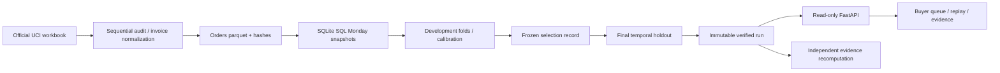

# Architecture and contracts

## Scientific boundaries

Feature events satisfy `ordered_at < as_of`. Target events satisfy `as_of <= ordered_at < as_of + 7 days`. Eligibility depends solely on historical qualifying orders. Calibration labels mature before evaluation starts; training labels mature before calibration starts. Model settings and source filters are explicit in MASTER_PLAN.md and code. Final model choice is immutable within a run.

SQLite SQL computes historical invoice-level aggregates and future labels in separate CTEs joined only after aggregation. The declared feature list excludes target, future order count and timestamp. Pipeline uses fixed seeds and one native thread for deterministic, low-resource local execution.

## Data and artifacts

Source and normalized caches have content hashes. Snapshot cache identity combines order hash, protocol and feature/SQL code hashes. Each experiment creates a fresh run directory; incomplete runs do not update latest.json. A final manifest is written only after reporting succeeds and source fingerprint remains unchanged. Run artifacts are not edited after completion.

Source.zip captures the package at experiment time, including SQL and web assets. Model bundles are saved for reproducibility but never loaded by the HTTP API. Artifact verification rebuilds final populations, labels and features from orders and recomputes reported metrics.

## API

| Route | Contract |
|---|---|
| GET /api/status | Readiness without synthetic fallback |
| GET /api/metadata | Available dates/models, selected run, source audit and protocol |
| GET /api/queue | Date/model/capacity/search/cohort; buyer probabilities; future columns only when reveal=true |
| GET /api/buyers/{id} | Pre-cutoff history and factual features; explicit optional future outcome |
| GET /api/export | CSV matching current queue filters and reveal state |
| GET /api/evidence | Measured aggregate model report, including all candidates |
| GET /api/report/download | Measured Markdown report |

Capacity is bounded 1–500. Date/model/cohort/search values are validated. Unknown dates produce 422; ineligible buyer 404; absent/corrupted run 503. A server pins one verified run after its first successful read. Restart to adopt a newer completed run.

The client aborts obsolete queue/detail requests and rejects stale responses. Date changes reset reveal. Failure hides stale data and offers retry. Queue filters change the selected population and its summaries. The local reveal control is educational; data is historical public evidence, not protected by authentication.

## Refined client and serving (v0.2)

React/TypeScript components live in frontend/src/. A current-query resource hook invalidates old results synchronously, aborts obsolete fetches and ignores late completions. CSV links exist only for a successful result matching the displayed controls. Search debounce also withholds stale data. Buyer details use the same date/model/reveal boundary plus buyer ID. Mobile inspection uses a native modal with explicit Tab wrapping, Escape, body-scroll restoration and return focus. URL/history preserves views and review filters.

Motion for React (formerly Framer Motion) provides shared navigation, short view/detail transitions, the native buyer-sheet entrance and an explicit outcome reveal. All displayed numbers remain actual measurements; reduced-motion paths preserve labels without spatial movement. Light and dark themes share semantic tokens.

Vite emits hashed production assets into src/reorderiq/web/ui/; the packaging script writes the app entry and runtime/font notices. FastAPI serves these assets from the same origin with gzip compression, one-year immutable caching only for successful hashed assets, no-cache HTML and no-store API responses. Store initialization is locked across concurrent first requests. Malformed artifact shapes produce recoverable 503 responses. Evidence verification compares exact buyer/date keys and declared candidates, and metric validation rejects invalid labels before integer conversion.

Application changes do not rewrite the original experiment source.zip or manifest. Model results remain tied to the frozen recorded experiment; current artifact verification rebuilds its historical features/labels and recomputes metrics independently.

## Operational scope

One local process loads prediction and order tables into memory. No background training, job queue, authentication, tenant isolation, scheduled retraining or external messaging. These mechanisms are not necessary to demonstrate the accepted offline question. Production use would require live-data validation, identity/access controls, monitoring and an outreach experiment before causal targeting claims.
