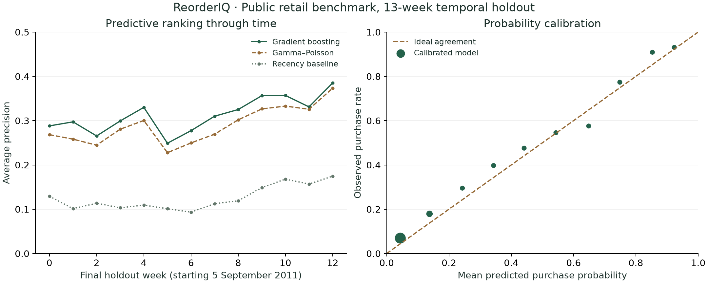

# ReorderIQ measured experiment

Run: `20261029T092203635364Z-627414f3`

Selected on development folds: **Gradient boosting**.

All metrics below are from the final temporal holdout. Models remain frozen throughout each fold.

| Candidate | Mean weekly AP | Brier (lower) | Precision @50 | Lift @50 |
|---|---:|---:|---:|---:|
| Recency baseline | 0.1254 | 0.0927 | 0.089 | 0.88 |
| Gamma–Poisson | 0.2892 | 0.0854 | 0.574 | 5.58 |
| Logistic regression | 0.3036 | 0.0844 | 0.571 | 5.56 |
| Gradient boosting | 0.3132 | 0.0841 | 0.592 | 5.76 |

Final population: 39,754 buyer-weeks, 3,874 distinct observed buyers, 13 weekly origins.

## Interpretation and limits

Average precision is computed separately each week, then equally averaged. Capacity denominators use the actual selected population. Lift is predictive enrichment over that week's order rate; it is not incremental orders caused by contact.

Dataset: Chen, D. (2012), Online Retail II, UCI, DOI:10.24432/C5CG6D, CC BY 4.0. UK giftware transactions from 2009-2011; many buyers are wholesalers. These are not Udaan records or current Indian retail conditions. Currency is GBP.

The target is a positive merchandise order placed, not net retained purchases, profit or permanent churn. Cancellations and non-merchandise lines are excluded, and future returns never rewrite historical eligibility. First-seen tenure is left truncated.

Calibration uses a separate later interval. The final period is evaluated after development-only model selection; no final-period tuning is authorized by this result. Other candidates are published for transparency, not to retrospectively replace the selected model.

Temporal block intervals describe stability over the observed test weeks; they do not establish causal, independent-buyer or population-wide significance. Permutation importance is predictive association and can understate correlated features.

See manifest.json, selection.json, report.json, snapshots.parquet, predictions.parquet and model bundles for exact provenance and reproduction evidence.

## Comparison with the statistical baseline

- average_precision: selected minus Gamma-Poisson = 0.024009; temporal stability interval [0.021034, 0.029479].
- precision_50: selected minus Gamma-Poisson = 0.018462; temporal stability interval [-0.007731, 0.033846].
- brier: selected minus Gamma-Poisson = -0.001321; temporal stability interval [-0.001674, -0.001171].

The top-50 precision interval spans zero. No causal effect or guaranteed queue improvement is established.

